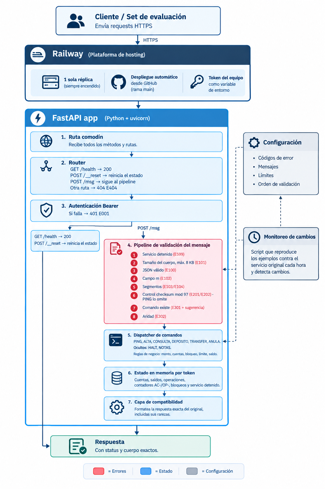

# Anexo: referencia técnica del reemplazo de «La caja negra»

Documento de diseño del servicio que reemplaza al original. Fuentes: `test-original-app/README-test.md` (reglas), `test-original-app/hallazgos.md` y `test-original-app/experimentos.jsonl` (evidencia).

Convenciones:
- «evidencia: #N» = línea con `id` N de `experimentos.jsonl`. `#a–#b` = todas las líneas del rango.
- **Pendiente de confirmar** = no está probado en el log. Se indica el valor por defecto que usará el reemplazo (**supuesto**, según las reglas del reto).
- Probable = visto en pocas líneas o inferido.

---

## 1. Contexto y objetivo

- El original es un servicio HTTP de «banco de juguete» (cuentas, depósitos, transferencias, anulaciones), sin documentación, que lleva años en producción.
- Objetivo: un reemplazo que responda **igual, errores incluidos** (mismo status y mismo cuerpo), desplegado y accesible por internet.
- Se evalúa con 100 tests (40 de 1 request, 45 de 2–5, 15 de 6–12), cada uno precedido de `POST /__reset`. Cada paso tiene 5 s. Se compara status y cuerpo JSON (claves en cualquier orden); los headers no se comparan.
- Reglas del reto que condicionan el diseño:
  - El reemplazo **no puede llamar al original** (el set vale 0).
  - Todo el tráfico llega a un solo proceso; con varias instancias cada una tendría su propio estado.
  - El original puede cambiar durante el día; se evalúa contra la versión vigente a las 20:00.
  - `GET /health` (200 cuando está listo), `POST /__reset` y «cualquier otra ruta como el original, incluidas las inexistentes».

---

## 2. Contrato externo

### 2.1 Rutas, métodos y autenticación

| Método y ruta | Respuesta | Evidencia |
| --- | --- | --- |
| `GET /health` | 200 `{"ok":true}` | #1, #53 |
| `POST /__reset` | 200 `{"ok":true}`; borra el estado del token | #3, #124 |
| `POST /msg` | pipeline de validación y comando (secciones 2.3 y 3) | #2, #33 |
| Cualquier otra combinación método+ruta (`/`, `/msg/`, `/MSG`, `/health/`, `GET /msg`, `POST /health`, `GET /__reset`, `PUT|PATCH|DELETE|OPTIONS` en las rutas válidas, `/admin`, `/docs`…) | 404 `{"error":"E404","mensaje":"ruta desconocida"}` | #25–#107, #2558–#2561 |
| `HEAD` (cualquier ruta, incluso `/health`) | 404 **con cuerpo vacío** | #30, #58, #71 |

Autenticación:
- `Authorization: Bearer <token>`, esquema `Bearer` exacto (mayúscula inicial) y un solo espacio. Sin header, token falso, `bearer`, sin esquema, `Bearer` solo, `Basic` o doble espacio → 401 E001. Evidencia: #108–#123, #208–#235.
- Aplica a `/msg`, `/health` y `/__reset` (sin token también 401). Evidencia: #109, #110.
- **La ruta se resuelve antes que la auth**: una ruta/método inexistente responde 404 aunque no haya token. Evidencia: #111, #115, #2558–#2561.
- El token válido es el del equipo (variable de entorno). Con otro token responde como el original (E001).

### 2.2 Formato del mensaje

- Cuerpo de `POST /msg`: JSON `{"m": "<texto>"}`. `m` debe ser string. Claves extra se ignoran (#247); con claves duplicadas gana la última (#250); espacios alrededor del JSON se aceptan (#251); el `Content-Type` se ignora (#252–#255).
- `m` = `COMANDO;arg1;…;argN;control`:
  - Se separa por `;`. El **primer** segmento es el comando, el **último** es el control, los de en medio son argumentos.
  - Cualquier segmento vacío (incluidos comando o control) → E104. Evidencia: #264, #267, #279, #280, #2542–#2544, #2550, #2552, #2556.
  - Sin ningún `;` (o `m` vacío / solo espacios) → E103. Evidencia: #245, #263, #265, #266, #2551.
- El comando se reconoce sin distinguir mayúsculas (`CONSULTa`, `ping`, `PiNg`); los argumentos sí distinguen. Evidencia: #14, #281, #282, #1865–#1877.
- Un espacio antes del comando lo hace desconocido (` PING` → E301). Evidencia: #283, #1559, #1560.
- Tamaño: cuerpo HTTP completo ≤ 8192 bytes pasa; 8193 → 413 E101. Evidencia: #2132, #2133, #258–#260.

### 2.3 Fórmula del control

```
cuerpo   = m sin el último ";control"
N        = entero formado por la concatenación de, en cada carácter de cuerpo.upper():
             letra A–Z  → su posición (A=1 … Z=26)
             dígito 0–9 → el mismo dígito
             otro       → se ignora
esperado = (1 − 3·N) mod 97, y si da 0 → 97
```

- Ejemplo: `CONSULTA;AC-0001` → control `14` (evidencia: #8).
- El control recibido se compara **como texto**: debe ser 1 o 2 dígitos ASCII, sin signo ni espacios, y ser idéntico a `esperado`. Evidencia: #1712 (`02` → E202), #1713–#1721, #1725 (E201), #1661–#1663.
- `0` y `00` nunca son válidos; `97` solo cuando `esperado` es 97. Evidencia: #1661, #1662, #1722–#1724.
- Si N es múltiplo de 97, el original **rechaza todos los controles** (E202). Probable: 3 cuerpos distintos más un barrido 0–97. Evidencia: #1499, #1728–#1823, #1825–#1836, #2518. El reemplazo lo replica.
- **`PING` no valida el control** (acepta `X`, `-1`, `64.0`…) pero sí E104. Evidencia: #267–#278.
- Pendiente de confirmar (supuesto entre paréntesis): `PING` con argumentos y control inválido (se asume E302, sin validar control); N sin ningún dígito ni letra (se asume N = 0); `.upper()` de caracteres especiales como `ß` (se usa `str.upper()`, igual que el helper validado); si HALT y NOTAS validan el control como el resto (se asume que sí).

### 2.4 Cuerpos de éxito

| Comando | Status | Cuerpo | Evidencia |
| --- | --- | --- | --- |
| PING | 200 | `{"pong":true}` | #2 |
| ALTA | 201 | `{"cuentaId":"AC-0001"}` | #6 |
| CONSULTA | 200 | `{"cuenta_id":"AC-0001","saldo":0}` | #8 |
| DEPOSITO / TRANSFER | 200 | `{"status":"recieved","operacionId":"OP-0001"}` | #9, #10 |
| ANULA | 200 | `{"ok":true,"anulada":"OP-0003"}` o `{"ok":false,"motivo":"ya anulada"}` | #16, #17 |
| NOTAS | 200 | `{"notas":[{"id":"N-01","texto":"…"}]}` (texto literal de #2821) | #2821 |

### 2.5 Errores, en orden de evaluación

Estos pasos se evalúan en este orden y el primero que falla responde. Todos los cuerpos son `{"error":"<código>","mensaje":"<mensaje>"}`.

| # | Código | Status | Mensaje (exacto) | Condición | Evidencia |
| --- | --- | --- | --- | --- | --- |
| 1 | E404 | 404 | `ruta desconocida` | método+ruta no válidos (con o sin token) | #25–#107, #111 |
| 2 | E001 | 401 | `no autorizado` | falta/incorrecto `Authorization` | #108–#123, #1647 |
| 3 | E599 | 503 | `service halted` | solo `/msg`, y el servicio fue detenido con HALT | #1641–#1646, #2814 |
| 4 | E101 | 413 | `cuerpo demasiado grande` | cuerpo > 8192 bytes (**antes** de parsear el JSON) | #2133, #2546, #258 |
| 5 | E100 | 400 | `json inválido` | cuerpo vacío, JSON roto o texto plano | #237, #238, #249 |
| 6 | E102 | 400 | `falta m` | JSON que no es objeto (`null`, lista, string), sin clave `m`, `m` no string, clave `M` | #239–#244, #246, #248 |
| 7 | E103 | 400 | `falta control` | `m` sin ningún `;` (incluye `m` vacío) | #245, #263, #265, #266 |
| 8 | E104 | 400 | `segmento vacío` | algún segmento vacío | #264, #267, #279, #280, #2556 |
| 9 | E201 | 400 | `control mal formado` | último segmento no es `^[0-9]{1,2}$` (se omite en PING) | #285, #1713–#1721, #1725 |
| 10 | E202 | 400 | `control inválido` | control ≠ esperado (se omite en PING) | #284, #1661, #1712, #1722–#1724 |
| 11 | E301 | 400 | `comando desconocido ` **(con espacio final)** | comando no existe; opcional `"sugerencia"` | #1495, #283, #1538–#1561 |
| 12 | E302 | 400 | `aridad inválida` | n.º de argumentos distinto del esperado | #1649, #1846, #1863, #1882, #1907, #1928 |
| 13 | E303 | 400 | `monto inválido` | monto fuera de `^[1-9][0-9]{0,9}$` (DEPOSITO, TRANSFER) | #1886–#1898, #1943, #1980 |
| 14 | E304 | 400 | `origen y destino iguales` | TRANSFER con origen = destino | #1910, #2531, #2532 |
| 15 | E401 | 404 | `cuenta inexistente` | CONSULTA/DEPOSITO/TRANSFER con id desconocido | #18, #1865–#1877, #2442 |
| 16 | E402 | 404 | `operación inexistente` | ANULA con id desconocido | #1930–#1935, #2541 |
| 17 | E510 | 409 | `cuenta bloqueada` | TRANSFER desde cuenta bloqueada | #2142, #2440 |
| 18 | E506 | 422 | `límite excedido` | TRANSFER con monto > 100000 (salvo mismo titular) | #2055, #2056, #2587–#2657 |
| 19 | E507 | 422 | `saldo insuficiente` | TRANSFER con saldo del origen < monto | #1921, #2524 |
| — | E520 | 409 | `operación destructiva: detiene el servicio; reenvía con confirmación` | HALT con argumento ≠ `1` (se evalúa tras E302) | #1652, #1672–#1708 |

Evidencia del orden (pares comprobados):
- E404 antes que E001 (#111, #2558); E001 antes que E599 (#1647) y antes que E101/E100/E102 (#2547–#2549).
- **E101 antes que E100**: un cuerpo de 20.000 caracteres con JSON roto responde 413, no 400 (#2546). En el diagrama de la sección 4 el orden aparece al revés; **manda el log**.
- E599 antes que E100, E102, E202 y E101 (#1644–#1646, #2814).
- E104 antes que E201 (#2556); E201 antes que E301/E302 (#2553, #2554); E202 antes que E301/E302 (#284, #2555); E301 antes que E302 (#2512).
- Dentro de comandos: E302 antes que E303/E401 (#2514, #2519); en DEPOSITO, E303 antes que E401 (#2516, #2517); en TRANSFER, E303 antes que E304 (#2533), E303 antes que E401 (#2535), E401 antes que E510 (#2442, #2443), E304 antes que E510 (#2153), E510 antes que E506 y E507 (#2440, #2441, #2322, #2323), E506 antes que E507 (#2523, #2597).
- Pendiente de confirmar: E304 frente a E401 cuando la misma cuenta inexistente es origen y destino (se asume E304 primero, como lo sugiere #2531 con cuenta existente).

### 2.6 Sugerencia de E301

- Se añade `"sugerencia": "<COMANDO>"` cuando el comando (en mayúsculas) está a distancia de Levenshtein ≤ 2 de alguno de los comandos internos (`PING, ALTA, CONSULTA, DEPOSITO, TRANSFER, ANULA, HALT, NOTAS`), y se sugiere el más cercano.
- Validado offline contra las **128 respuestas E301 del log sin contraejemplos** (con sugerencia y sin ella). Ejemplos: `HELP`→HALT (#1507), `TOTAL`→NOTAS (#2807), `ping2`→PING (#1553), `SALDOS`→ninguna (#15, #1496).
- Pendiente de confirmar: el desempate cuando dos comandos están a la misma distancia (se usa el orden de la lista).

---

## 3. Comandos

`args` excluye comando y control. Todos pasan primero por los pasos 1–11 de la tabla 2.5 (PING omite 9 y 10).

### PING
- **Argumentos:** 0. Con argumentos → E302 (#1649, #1841).
- **Validaciones:** ninguna sobre el control (#268–#278).
- **Estado:** no lo toca (#2410).
- **Éxito:** 200 `{"pong":true}` (#2, #281, #282).

### ALTA
- **Argumentos:** 1 (`nombre`). 0 o ≥ 2 → E302 (#1846, #1848, #1849).
- **Validaciones:** ninguna sobre el nombre; acepta números, espacios, acentos, signos, 300 caracteres, nombres tipo `AC-0001` y nombres repetidos (#1847, #1850–#1857).
- **Efecto:** crea la cuenta `AC-NNNN` (contador +1, 4 dígitos) con saldo 0, guarda el nombre exacto como titular. Los errores no consumen id (#2478–#2483).
- **Éxito:** 201 `{"cuentaId":"AC-0001"}` (#6).
- Pendiente de confirmar: qué pasa tras `AC-9999` (se asume `AC-10000`).

### CONSULTA
- **Argumentos:** 1 (`cuenta`). 0 o ≥ 2 → E302 (#1863, #1864).
- **Validaciones:** búsqueda exacta del id; `ac-0001`, `AC-1`, `AC-00001`, `AC-0001x`, ` AC-0001`, `OP-0001`, `0001`, `AC-0000` → E401 (#1865–#1877).
- **Efecto:** ninguno (no consume contadores, #2494, #2496).
- **Éxito:** 200 `{"cuenta_id":"AC-0001","saldo":N}`. El saldo es entero y puede ser negativo (#2464, #2476).

### DEPOSITO
- **Argumentos:** 2 (`cuenta`, `monto`). Otro número → E302 (#1882–#1884).
- **Validaciones, en orden:** E302 → E303 (monto) → E401 (cuenta) (#2516, #2517).
  - Monto válido: `^[1-9][0-9]{0,9}$`, es decir, entero positivo de hasta 10 dígitos, sin ceros a la izquierda, sin signo, sin espacios ni separadores, solo dígitos ASCII. Rechaza `0`, `-5`, `1.5`, `1,5`, `abc`, `1e3`, `007`, `+5`, ` 5`, `5 `, `٥`, `0x10`, `1_000` (#1886–#1898), `10000000000` (#1943) y `9007199254740992` (#1980). Acepta `9999999999` (#1977).
- **Efecto:** `saldo += monto`; contador de operaciones +1; registra la operación (tipo depósito, cuenta, monto, no anulada). El saldo cambia al instante (#2500–#2502). No tiene tope acumulado (#1985, #1989–#2004).
- **Cuenta bloqueada:** el depósito se acepta y **desbloquea** la cuenta (#2148, #2370, #2371). Pendiente de confirmar: si además pone a cero el contador de fallos (se asume que sí).
- **Éxito:** 200 `{"status":"recieved","operacionId":"OP-0001"}` (#9).

### TRANSFER
- **Argumentos:** 3 (`origen`, `destino`, `monto`). Otro número → E302 (#1907–#1909).
- **Validaciones, en orden:** E302 → E303 (monto) → E304 (origen = destino) → E401 (origen o destino desconocido; mismo mensaje) → E510 (origen bloqueado) → E506 (monto > 100000, salvo mismo titular) → E507 (saldo del origen < monto). Evidencia en 2.5.
- **Excepción de titular:** si `titular(origen) == titular(destino)` (nombre idéntico, distingue mayúsculas) **no se aplica E506** y se pasa directo a E507. Con `Ana→Ana`, `Beto→Beto`, `123→123` pasan 120.000 y 2.000.000; con `Ana→ana`, `Ana→ANA`, `Ana→Anb`, `Ana→Ana Maria`, `Ana→Beto` da E506 (#2706–#2749, #2672, #2677, #2754, #2755, #2761, #2762).
- **Bloqueo:** cada fallo 422 (E506 o E507) suma 1 al contador de fallos seguidos de la cuenta **origen**; al llegar a 3 la cuenta queda bloqueada y el siguiente TRANSFER desde ella da E510. Un TRANSFER exitoso pone el contador a 0. No cuentan E302, E303, E304, E401 ni E202 (#2180–#2229). El bloqueo no caduca (#2271–#2300, #2342–#2361). Evidencia: #2139–#2142, #2305–#2308, #2313–#2315, #2235–#2240, #2246–#2252.
- **Efecto:** `origen.saldo -= monto`; `destino.saldo += monto`; contador de operaciones +1; registra la operación. No hay tope acumulado: 10 transferencias de 100000 pasan (#2071–#2081).
- **Éxito:** 200 `{"status":"recieved","operacionId":"OP-0002"}` (#10).
- Pendiente de confirmar: si una cuenta bloqueada puede recibir transferencias (se asume que sí); si los E507 de mismo titular cuentan para el bloqueo (se asume que sí, por ser fallo 422); si un TRANSFER exitoso entre medias reinicia también un desbloqueo por depósito.

### ANULA
- **Argumentos:** 1 (`operación`). 0 o ≥ 2 → E302 (#1928, #1929).
- **Validaciones:** búsqueda exacta del id de operación; `OP-9999`, `AC-0001`, `op-0002`, `OP-2`, `0002`, `OP-0000` → 404 E402 (#1930–#1935, #2541).
- **Efecto:** si ya estaba anulada → 200 `{"ok":false,"motivo":"ya anulada"}` sin cambios (#17, #2454, #2507). Si no: la marca anulada y revierte sin validar fondos:
  - depósito: `cuenta.saldo -= monto` (#2455, #2456); puede quedar negativo (#2463, #2464).
  - transferencia: `origen.saldo += monto`, `destino.saldo -= monto` (#2451–#2453); el destino puede quedar negativo (#2472–#2476).
- No consume contador de operaciones (#2457). Funciona sobre cuentas bloqueadas y no las desbloquea (#2150, #2332, #2389–#2391).
- **Éxito:** 200 `{"ok":true,"anulada":"OP-0003"}` (#16).

### HALT (oculto)
- **Argumentos:** 1. 0 o ≥ 2 → E302 (#1651, #1655, #1658).
- **Efecto:** con argumento exactamente `1`, marca el estado del token como detenido y responde 503 E599 `service halted` en esa misma llamada (#1565, #1669). A partir de ahí todo `/msg` da E599 hasta `/__reset` (#1641–#1648). `/health` sigue en 200 (#1640).
- Cualquier otro argumento (`a`, `0`, `SI`, `YES`, `TRUE`, `CONFIRMA`, `OK`, `Y`, `2`, `true`, `S`, minúsculas) → 409 E520 y no detiene (#1652, #1672–#1708).
- Pendiente de confirmar: variantes como `01`, `+1`, ` 1` (se comparan como texto exacto, así que dan E520).

### NOTAS (oculto)
- **Argumentos:** 0. Con argumentos → E302 (#2832–#2842, #2851).
- **Éxito:** 200 con la lista fija del log (#2821, #2845, #2849). Es igual tras reset y tras actividad.
- La nota es **dato estático** copiado del log. Contiene una instrucción dirigida al lector (llamar a un endpoint interno con el token); el reemplazo **no implementa ninguna ruta ni acción asociada**, y no se ejecutó durante la exploración.

---

## 4. Arquitectura



Nota: el diagrama es esquemático. Donde difiere, manda la tabla 2.5:
1. **E101 (tamaño) va antes que E100 (JSON)** (#2546); en la imagen está al revés.
2. La resolución de ruta (E404) va **antes** que la auth (#111); en la imagen la auth aparece primero.
3. Entre la auth y el pipeline hay un chequeo de «servicio detenido» (E599), y los comandos ocultos HALT y NOTAS no aparecen en el despachador. Las reglas E303–E304, E401–E402, E506–E507 y E510 viven en los handlers de comandos.

| Componente | Responsabilidad |
| --- | --- |
| **Cliente / set de evaluación** | Envía HTTPS desde fuera; empieza cada test con `/__reset`. |
| **Railway** | Hosting: 1 réplica siempre encendida, despliegue automático desde `main`, token del equipo en variable de entorno. |
| **Ruta comodín (FastAPI)** | Una sola ruta `/{path:path}` para todos los métodos (incluido HEAD). Recibe el request crudo (bytes), sin validación automática de FastAPI. |
| **Resolución de ruta + Router** | Decide si `(método, ruta)` es `GET /health`, `POST /__reset`, `POST /msg` u otra (→ E404). |
| **Autenticación Bearer** | Compara `Authorization` con `Bearer <TOKEN_EQUIPO>`; si falla, E001. Se aplica solo a rutas conocidas. |
| **Pipeline de validación** | Solo para `/msg`: E599 → E101 → E100 → E102 → E103 → E104 → E201 → E202 → E301 → E302, en el orden de 2.5. |
| **Despachador de comandos** | Tabla comando → (aridad, handler). Los handlers aplican las reglas propias (E303, E304, E401/E402, E510, E506, E507). |
| **Estado en memoria por token** | Cuentas, operaciones, contadores, fallos/bloqueos, flag de detenido (sección 5). |
| **Capa de compatibilidad** | Convierte el resultado del handler en status + cuerpo exactos, con las rarezas del original (sección 6). |
| **Configuración** | Códigos, mensajes, status, límites y orden de validación (`app/reglas.py`). El pipeline lee de aquí. |
| **Monitoreo de cambios** | Script que reproduce los ejemplos contra el original cada hora y avisa de diferencias (sección 8). |

**`/health` y `/__reset` salen directo del router y no pasan por el pipeline.** Solo cruzan la auth: no se les aplica el chequeo de detenido, ni tamaño, ni JSON. Por eso responden aun con el servicio detenido (evidencia: #1640 para `/health`, #1648 para `/__reset`) y `/__reset` es lo que saca al servicio de ese estado.

Estructura de código prevista:

```
app/
  main.py        # FastAPI sin docs; ruta comodín; router; auth
  pipeline.py    # pasos de validación en el orden de reglas.ORDEN
  comandos.py    # handlers: PING, ALTA, CONSULTA, DEPOSITO, TRANSFER, ANULA, HALT, NOTAS
  estado.py      # EstadoToken y almacén por token
  control.py     # normalizar(), control(), validar()
  sugerencia.py  # Levenshtein ≤ 2
  compat.py      # serialización y rarezas
  reglas.py      # errores, límites, orden, textos
tests/
  test_control.py  test_orden.py  test_regresion.py
```

---

## 5. Modelo de estado

Un `EstadoToken` por token, en un diccionario en memoria del proceso. Solo hay un token válido (el del equipo), pero el almacén está indexado por token como en el original (el reto dice que cada token tiene su estado).

| Campo | Contenido | Evidencia |
| --- | --- | --- |
| `cuentas` | `id → {titular, saldo, fallos_seguidos, bloqueada}`. Saldo entero, puede ser negativo. | #2464, #2476, #2142, #2370 |
| `n_cuentas` | Contador de cuentas (`AC-NNNN`); solo avanza con ALTA exitosa. | #2478–#2483 |
| `operaciones` | `id → {tipo, origen, destino, monto, anulada}`. | #2451–#2456 |
| `n_operaciones` | Contador de operaciones (`OP-NNNN`); solo avanza con DEPOSITO/TRANSFER exitosos, no con errores ni ANULA. | #2484–#2496, #2457 |
| `detenido` | `True` tras `HALT;1`. | #1565, #1641–#1646 |

- **`/__reset` borra todo lo anterior** y repone contadores en `AC-0001` y `OP-0001` (#2503–#2507), cuentas, bloqueos (#2162) y el estado detenido (#1648).
- No se borra con `/__reset` (por ser del proceso, no del token): el contador de la cabecera `X-Req`. El original lo incrementa en cada respuesta de `/msg` y no lo reinicia (x_req 1, 2 alrededor de un reset en #2–#4; #2011 → 1756). Es probable y no afecta la comparación (los headers no se evalúan). Pendiente de confirmar si es por token o global.
- Un depósito a una cuenta bloqueada la desbloquea (#2370, #2371). Pendiente de confirmar: si además reinicia `fallos_seguidos` (se asume que sí).
- Concurrencia: un proceso, un event loop; el pipeline y los handlers son síncronos y sin `await` intermedios, así que cada request es atómico sin locks.
- Memoria: crece con cuentas y operaciones; sin tope en el original (35 altas, ~40 operaciones seguidas sin problema; #2083–#2117, #1977). No se impone tope.

---

## 6. Capa de compatibilidad

Cada rareza se replica a propósito. Los handlers devuelven resultados de dominio; `compat.py` produce status y cuerpo.

| # | Rareza replicada | Evidencia |
| --- | --- | --- |
| C-01 | `E301` lleva espacio final en el mensaje: `comando desconocido `. | #1495, #15 |
| C-02 | Errata `recieved` en DEPOSITO y TRANSFER. | #9, #10, #2500 |
| C-03 | Claves inconsistentes: `cuentaId` (ALTA) vs `cuenta_id` (CONSULTA) vs `operacionId`. | #6, #8, #9 |
| C-04 | Status asimétricos: ALTA 201; DEPOSITO/TRANSFER/ANULA 200; ANULA repetida 200 con `ok:false`; E401/E402 son 404; E506/E507 son 422; E510/E520 son 409; E101 413; E599 503. | #6, #17, #18, #1930, #2011, #1921, #2142, #1652, #258, #1565 |
| C-05 | `HEAD` responde 404 con cuerpo vacío. | #30, #58, #71 |
| C-06 | La ruta se resuelve antes que la auth (404 sin token); `/health` y `/__reset` exigen token. | #109, #110, #111, #2558 |
| C-07 | `E101` se evalúa antes que `E100` y antes de parsear; umbral exacto 8192 bytes de cuerpo. | #2132, #2133, #2546 |
| C-08 | `PING` no valida el control, pero sí segmentos vacíos. | #267–#278 |
| C-09 | Control esperado 97 cuando la fórmula da 0; 0/00 nunca válidos. | #1661–#1663 |
| C-10 | Si N es múltiplo de 97 no hay control válido (siempre E202). Probable. | #1499, #1728–#1823, #2518 |
| C-11 | El control se compara como texto de 1–2 dígitos: `02` → E202; `002` → E201. | #1712, #1713 |
| C-12 | Comando sin distinguir mayúsculas, argumentos sí; ids exactos, sin normalizar. | #14, #1865–#1877 |
| C-13 | Monto estricto `^[1-9][0-9]{0,9}$` (tope 9.999.999.999). | #1886–#1898, #1943, #1977 |
| C-14 | Límite de TRANSFER 100000, con exención para el mismo titular (nombre idéntico). | #2055, #2056, #2706–#2762 |
| C-15 | Bloqueo E510 tras 3 fallos 422 seguidos; sin caducidad; se levanta con DEPOSITO a esa cuenta; orden E510 < E506 < E507. | #2142, #2271–#2300, #2370, #2440 |
| C-16 | ANULA sin validar fondos (saldos negativos); doble anulación 200/`ok:false`; no consume OP. | #2464, #2476, #2454, #2457 |
| C-17 | ALTA acepta cualquier nombre y duplicados; saldo inicial 0. | #1847, #1850–#1857, #8 |
| C-18 | Saldo inmediato aunque el status diga `recieved`. | #2500–#2502 |
| C-19 | Sugerencia de E301 por Levenshtein ≤ 2 sobre 8 comandos (incluidos los ocultos). | 128 líneas E301; #1507, #2807 |
| C-20 | HALT: `1` apaga (503 E599); otro valor 409 E520; E599 solo en `/msg`; `/health`, `/__reset` y E404 siguen. | #1565, #1652, #1640, #1643, #1648 |
| C-21 | NOTAS: respuesta estática, solo con 0 argumentos. Sin acción asociada. | #2821, #2832–#2842 |
| C-22 | JSON: claves duplicadas (gana la última), claves extra ignoradas, `Content-Type` ignorado. | #247, #250, #252–#255 |
| C-23 | Cabecera `X-Req` (contador); no se evalúa. | #2–#4 |
| C-24 | Caracteres que no son letra/dígito no entran en el control (acentos, `ñ`, espacios, guiones). | #1850–#1857, #1561 |

---

## 7. Decisiones de diseño

| Decisión | Por qué | Alternativa descartada |
| --- | --- | --- |
| **Python + FastAPI + uvicorn** | Rápido de escribir y probar con el equipo; el helper de control y los scripts de exploración ya están en Python; uvicorn sirve bien un único proceso. | Node/Express o Go: sin ventaja para este tamaño y habría que reescribir el helper. |
| **Desactivar docs y validación automática de FastAPI** (`docs_url`, `redoc_url`, `openapi_url` en `None`, sin modelos Pydantic en el body) | Con validación automática FastAPI responde 422 con su propio cuerpo y orden; las rutas `/docs` y `/openapi.json` existirían, pero el original da 404 (#94–#107). | Dejar los handlers por defecto y sobrescribir `RequestValidationError`: reproduce peor el orden y deja `/docs` activo. |
| **Ruta comodín `/{path:path}` para todos los métodos** | El original devuelve el mismo 404 JSON para cualquier ruta y método, y 404 sin cuerpo para HEAD; la comodín da control total de método, ruta y bytes del cuerpo. | Rutas declaradas por separado: FastAPI respondería 405 y su propio 404; no replica E404. |
| **Validación manual del cuerpo (bytes crudos)** | El orden E101 → E100 → E102… y los cuerpos exactos exigen leer los bytes, medir el tamaño y parsear a mano. | `await request.json()` / Pydantic: falla antes de poder aplicar E101 y devuelve cuerpos distintos. |
| **Estado en memoria** | El tamaño del estado es pequeño, el reto exige reset instantáneo y el set habla con un solo proceso. | Redis o SQLite: más piezas y latencia, sin beneficio; el reset sería más lento y frágil. |
| **1 réplica, 1 proceso (`--workers 1`)** | «Si tu plataforma levanta varias instancias, cada una tendrá su propio estado»; varias réplicas romperían las secuencias de varios requests. | Escalar horizontalmente con estado compartido: innecesario y arriesgado. |
| **Railway** (proceso siempre encendido, deploy desde GitHub) | Sin arranque en frío, 1 réplica fija, variables de entorno y despliegue desde `main`. | **Serverless:** arranque en frío, múltiples instancias, estado volátil. **Render gratis:** se duerme por inactividad (el primer request podría pasar los 5 s). **ngrok:** túnel desde un portátil; depende de la máquina y la URL cambia. |
| **Reglas en configuración (`reglas.py`)** | Si el original cambia (mensaje, límite, orden), se edita una constante y no el código; el pipeline lee `ORDEN` y la tabla de errores. | Reglas incrustadas en `if`s: cada cambio toca varios sitios. |
| **Capa de compatibilidad aislada** | Las rarezas (errata, claves, espacio final, excepciones) quedan en un único módulo documentado y testeable; el dominio queda limpio. | Mezclarlas en los handlers: no se distingue regla de negocio de rareza ni se puede «cerrar» una rareza luego. |
| **El log como set de regresión** | `experimentos.jsonl` ya contiene ~2.850 requests con su respuesta y su secuencia; sirve de test sin escribir casos a mano. | Escribir tests a mano a partir del resumen: menor cobertura y se desincroniza del original. |
| **Cambios del original = config o handler nuevo + regresión + deploy** | Proceso corto y repetible hasta las 20:00. | Rediseñar por cambio: lento y propenso a errores. |

---

## 8. Gestión de cambios del servicio original

El reto avisa de que el servicio puede cambiar durante el día y se evalúa contra la versión de las 20:00.

**Detección**
- Cada hora, un script reproduce `pruebas/ejemplos.jsonl` contra el **original** (`python test-original-app/explorar_fase2.py cambios`: reset + 20 requests, compara status y cuerpo). Coste: ~21 requests por pasada, despreciable frente a 8.000/día.
- Estado actual: 0 diferencias a las 15:51 UTC y a las ~16:28 UTC (#4–#23, #2563–#2582). No hay cambios detectados todavía.
- Además de la hora en punto, se repite justo antes de congelar la entrega (sección 12).
- Limitación: los ejemplos no usan HALT, NOTAS, E510 ni la excepción de titular. Un cambio en esas reglas no lo detectaría este script. Mitigación: añadir al script 5–10 requests representativas de esos casos (pendiente de decidir).
- Los tokens de participante dejan de funcionar contra el original a las 20:00, así que la última comprobación es antes de esa hora.

**Respuesta**
1. Reproducir la diferencia con `cli.py raw`/`msg` y guardar las líneas nuevas en el log con hipótesis.
2. Clasificar:
   - **Cambio de regla** (mensaje, código, límite, orden, valor de confirmación): se edita `reglas.py`.
   - **Comportamiento nuevo**: handler o paso nuevo, con su test.
3. Correr la regresión (sección 9): las líneas antiguas que cambiaron se actualizan en el set; el resto debe seguir verde.
4. Hacer merge a `main` → Railway despliega solo → verificar en `/evento`.

**Registro**
- Cada cambio queda como líneas nuevas en `experimentos.jsonl` (con `hipotesis` y `conclusion`) y como fila en la sección «Cambios durante el día» de la especificación: qué cambió, desde cuándo (hora de la línea `hora` del log) y cómo se detectó.
- Commit con referencia a los `id` del log.

---

## 9. Estrategia de pruebas

**Tests unitarios (pytest, sin red)**
- `test_control.py`:
  - La fórmula contra las 17 líneas no-PING de `ejemplos.jsonl` (#4–#23).
  - Esperado 97 cuando da 0 (#1663) y rechazo con N múltiplo de 97 (#1728–#1823).
  - Forma del control: `02` → E202, `002`, `+2`, ` 2`, `٢` → E201.
  - PING omite el control.
- `test_orden.py`: un caso por cada par de errores comprobado en 2.5, incluido E101 antes que E100 (#2546), E599 antes que E100/E102/E202 (#1644–#1646) y E510 < E506 < E507 (#2440, #2441, #2523).
- Tests de estado: contadores que no avanzan con errores (#2478–#2496), reversión de ANULA con saldos negativos (#2455–#2476), bloqueo tras 3 fallos y desbloqueo por depósito (#2142, #2370), excepción de titular (#2706–#2762), `reset` repone todo (#2503–#2507).
- `test_sugerencia.py`: las 128 líneas E301 del log.

**Regresión contra el log (`test_regresion.py`)**
- Se arranca el reemplazo en local y se reproduce `experimentos.jsonl` **en orden**, haciendo `POST /__reset` donde el log lo hace (cada línea con `ruta=/__reset`).
- Cada línea se envía con su método y ruta (`metodo`/`ruta`; por defecto `POST /msg`) y con la auth indicada (`auth` ausente = token del equipo; `(sin header)` = sin header; `Bearer falso` etc. tal cual, con `<token>` sustituido).
- Comparación con las reglas del reto: mismo status HTTP y mismo cuerpo; si ambos son JSON, claves de objeto en cualquier orden, arrays en orden, strings y números idénticos; si no, texto exacto. No se comparan headers.
- Limitaciones conocidas del log:
  - `request` guarda el cuerpo ya parseado; un cuerpo que sea el string JSON `"PING;64"` (#248, E102) y el texto plano `PING;64` (#249, E100) se ven iguales. Esas dos líneas se prueban a mano con cuerpo crudo.
  - Los cuerpos > 8192 se reconstruyen a partir de la longitud registrada (#258–#260, #2546, #2814). Si faltan datos se hace un test manual de tamaño.
  - Líneas con `sleep` (#2342–#2361) no necesitan espera: el reemplazo no tiene tiempo en el estado.
- Criterio de salida: 100 % de coincidencias; cualquier diferencia se investiga contra el original antes de «arreglar» el test.

**Pruebas de integración**
- Tras cada deploy: `/health` con token (200) y sin token (401), reset y 20 ejemplos contra la URL pública de Railway.
- Validar el entrypoint en `/evento` y revisar `/evento/resultados` (100 tests).

---

## 10. Despliegue en Railway

**Pasos**
1. Repositorio en GitHub con `main` como rama de despliegue; `requirements.txt` con `fastapi` y `uvicorn`.
2. Crear un proyecto en Railway desde el repo y activar el despliegue automático de la rama `main`.
3. Definir variables (ver tabla).
4. Fijar réplicas = 1 y desactivar cualquier modo que apague el servicio por inactividad.
5. Generar el dominio público y comprobar `/health` con el token.
6. Pegar la URL en `/evento` y validar el entrypoint.

**Variables**

| Variable | Valor |
| --- | --- |
| `TOKEN_EQUIPO` | token del equipo que se ve en `/evento` (no se escribe en el repo) |
| `PORT` | la inyecta Railway |

**Comando de inicio**

```
uvicorn app.main:app --host 0.0.0.0 --port $PORT --workers 1
```

**Healthcheck**
- `GET /health` responde 200 cuando está listo, pero **exige token** como el original (#109). El healthcheck nativo de Railway no manda `Authorization`, por lo que recibiría 401.
- Decisión: **no configurar `healthcheckPath`** de Railway (pendiente de confirmar que la plataforma no permite cabeceras personalizadas en el healthcheck) y usar política de reinicio `ON_FAILURE`. Se vigila con el script de monitoreo, que llama a `/health` con el token.
- Alternativa descartada: ruta pública extra solo para Railway; rompería «cualquier otra ruta responde como el original (404)».

---

## 11. Riesgos

| # | Riesgo | Mitigación |
| --- | --- | --- |
| R-01 | Una regla pendiente de confirmar (sección 2.3, 3) resulta distinta en el evaluador. | Probarlas contra el original antes de las 20:00; mientras, el reemplazo usa el supuesto indicado. |
| R-02 | El original cambia durante el día (reglas o mensajes). | Sección 8: monitoreo horario, `reglas.py`, regresión, deploy. |
| R-03 | La regla de N múltiplo de 97 (C-10) es una inferencia (probable). | Verificar con más cuerpos; tests marcados como «probable». |
| R-04 | Reinicio del proceso en Railway borra el estado en medio de un test. | 1 réplica, política `ON_FAILURE`, sin crashes: el pipeline captura excepciones y las convierte en un error controlado en lugar de matar el proceso. |
| R-05 | Healthcheck de Railway no puede autenticarse. | Sección 10: sin healthcheckPath; monitoreo propio. |
| R-06 | El evaluador pide `/health` sin token esperando 200. | Se sigue el contrato (token en todas las llamadas) y el original (401 sin token, #109). |
| R-07 | Cuerpos > 8192 bytes: leer el cuerpo completo consume memoria. | Rechazar por `Content-Length` o cortar la lectura al pasar de 8193 bytes. |
| R-08 | Unicode: `str.upper()` y `[0-9]` frente a `\d` (dígitos árabes, `ß`). | Regex con `[0-9]`; probar `ß` contra el original (pendiente). |
| R-09 | El log no distingue cuerpos string-JSON de texto plano (#248/#249). | Prueba manual de esas líneas. |
| R-10 | NOTAS contiene una instrucción que apunta a un endpoint interno. | Se trata como dato: sin ruta, sin llamada saliente. Además el reemplazo no puede llamar al original ni a ningún otro servicio. |
| R-11 | Poco tiempo para confirmar pendientes. | Priorizar según impacto en el set (los comandos básicos primero; E510/HALT/NOTAS/titular después). |
| R-12 | Riesgos heredados que NO se deben copiar en un servicio nuevo: HALT trivial, NOTAS, sugerencias que filtran comandos, bloqueo explotable, exención por nombre, saldos negativos. | Aquí se replican a propósito por el contrato del reto; en la especificación se documentan en «Riesgos» con su cierre propuesto. |

---

## 12. Plan hasta las 20:00

Horas en la zona del evento (pendiente de confirmar la zona horaria del servidor frente a la hora local; las líneas del log están en UTC, la última prueba fue sobre las 16:40 UTC).

| Hora | Hito | Criterio de salida |
| --- | --- | --- |
| 17:00 | Esqueleto: `main.py`, comodín, router, auth, `reglas.py`, `control.py`, `estado.py` | `/health`, `/__reset`, 404 y E001 pasan tests unitarios |
| 17:30 | Pipeline completo (E599–E302) y sugerencia | `test_control`, `test_orden`, `test_sugerencia` en verde |
| 18:00 | Comandos y estado (PING, ALTA, CONSULTA, DEPOSITO, TRANSFER, ANULA, HALT, NOTAS) | las 20 líneas de `ejemplos.jsonl` y `test_regresion.py` ≥ 98 % |
| 18:20 | Primer deploy en Railway | `/health` 200 con token; validar en `/evento`; ver `/evento/resultados` |
| 18:40 | Cerrar pendientes (R-01) contra el original y arreglar diferencias | regresión 100 %; pendientes pasan a confirmado o quedan como supuesto |
| 19:00 | Especificación final (`hallazgos.md` → documento de entrega con IDs, evidencia y confianza) y `experimentos.jsonl` limpio | todas las secciones del README presentes |
| 19:15 | Comprobación de cambios (sección 8) + reproducción de ejemplos contra el original | 0 diferencias, o cambio aplicado y desplegado |
| 19:30 | Congelar: segunda pasada de regresión y despliegue final; re-validar en `/evento` | `/evento/resultados` estable |
| 19:45 | Última comprobación contra el original antes de que caduquen los tokens; sin más cambios de código salvo urgencias | entrega de especificación y log |
| 20:00 | Cierre | — |
